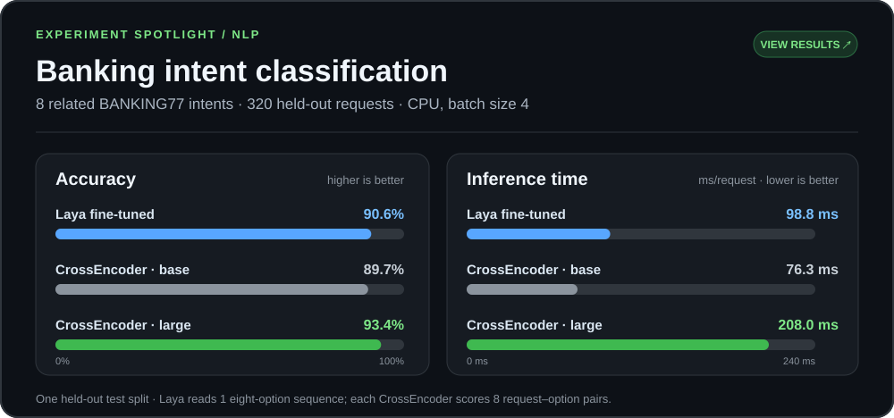

# Machine Learning Notes & Labs

Study notes and hands-on notebooks across machine learning, NLP, computer vision, and LLMs. I use this repository to connect model architecture, training objectives, evaluation, and implementation. The indexes below describe the scope of each item.

## Start here

- [Laya vs CrossEncoder classification lab](labs/nlp/laya-vs-cross-encoder/README.md) — reproducible training on eight BANKING77 intents, with [held-out results](labs/nlp/laya-vs-cross-encoder/RESULTS.md).
- [Laya: typed decision model](notes/llm/laya.md) — a bilingual walkthrough from a customer request and typed questions to option probabilities, model architecture, and loss functions.
- [Training and optimization](notes/foundations/training-and-optimization.md) — working notes on gradients, backpropagation, cross-entropy, calibration, and training efficiency.
- [Segmentation metrics](notes/cv/segmentation-metrics.md) — notes on pixel accuracy, Dice, IoU, and mAP.

## Browse

| Section | Contents |
| --- | --- |
| [Notes](notes/README.md) | Concept explanations, model analyses, and research reading notes |
| [Labs](labs/README.md) | Learning notebooks and small code experiments, grouped by domain |
| [References](references/README.md) | PDFs retained as background reading |

The notebooks document exploration and learning. Their titles do not imply benchmark results or production readiness. Each lab is listed separately so its purpose is clear before opening it.

## Repository layout

```text
notes/       Written explanations and research notes
labs/        Notebooks and code used while learning or experimenting
assets/      Images used by the notes
references/  Background PDFs
```

## Experiment spotlight

Selected results from completed labs. Click a chart for the full protocol, metrics, and interpretation limits.

### Laya (Jev) vs Cross Encoder

[](labs/nlp/laya-vs-cross-encoder/RESULTS.md)

Eight related payment intents, 320 held-out requests. The [lab](labs/nlp/laya-vs-cross-encoder/README.md) includes the training code and reproduction steps; the linked results page explains the remaining differences between the systems.
