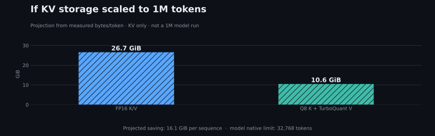

# TurboQuant KV cache on an M1 Max

This exploratory lab compares FP16 K/V with **Q8_0 keys + TurboQuant 4-bit values** on Qwen2.5-1.5B-Instruct Q8_0. The [protocol and reproduction steps](README.md), [short-context CSV](results.csv), [long-context CSV](results_long.csv), and case definitions ([short](cases.json), [long](cases_long.json)) are available here. All prompts are synthetic.

## 1. Measured KV cache allocation

| Input tokens | Configured context capacity | FP16 KV | TurboQuant KV | KV reduction |
| --- | ---: | ---: | ---: | ---: |
| ~6,538 | 8,192 | 224 MiB | 89 MiB | 60.2% |
| 16,014 | 18,432 | 504 MiB | 201 MiB | 60.2% |
| 30,290 | 32,768 | 896 MiB | 357 MiB | 60.2% |

The backend reserves KV memory for the configured **context capacity**, which exceeds the prompt length. This chart and the whole-model chart use the **same x-axis positions for the same capacities**, so the KV point can be compared directly with its stacked-bar segment. These are separate process runs, not live growth of one process's cache. The ~6.5k values are medians across four prompts; the 16k and 30.3k values are medians across two prompts each.

## 2. What would one million allocated tokens require?

The two longer capacities give exactly **28 KiB per allocated token** for FP16 and **11.16 KiB per allocated token** for the experimental Q8 K + TurboQuant V format. Holding the *same model architecture and cache format* fixed, one million allocated tokens would require **26.7 GiB versus 10.6 GiB of KV storage**, a difference of 16.1 GiB per sequence.

This is **arithmetic, not a 1M-token benchmark**. The [model configuration](https://huggingface.co/Qwen/Qwen2.5-1.5B-Instruct/blob/main/config.json) limits native positions to 32,768 tokens. Its 1M accuracy, prefill time, temporary memory, and full Metal allocation cannot be inferred from this chart. The local setup also differs from Google's [TurboQuant research evaluation](https://research.google/blog/turboquant-redefining-ai-efficiency-with-extreme-compression/): only the values use TurboQuant 4-bit here; the keys use Q8_0.

## 3. Whole model allocation at measured lengths

| Input tokens | FP16 total Metal | TurboQuant total Metal | Reduction | FP16 peak RSS | TurboQuant peak RSS |
| --- | ---: | ---: | ---: | ---: | ---: |
| ~6,538 | 2,454 MiB | 2,319 MiB | 135 MiB / 5.5% | 2,177 MiB | 2,041 MiB |
| 16,014 | 3,251 MiB | 2,948 MiB | 303 MiB / 9.3% | 2,495 MiB | 2,192 MiB |
| 30,290 | 4,368 MiB | 3,829 MiB | 539 MiB / 12.3% | 2,947 MiB | 2,408 MiB |

The backend reports **1,801 MiB of model allocation** across these runs. Compute buffers also remain; the chart derives their size as total Metal minus model minus KV. At 30.3k, KV occupies 20.5% of FP16 total Metal allocation and 9.3% of TurboQuant total Metal allocation. Peak process RSS comes separately from macOS `/usr/bin/time -l`. It is a different view of memory and must not be added to the backend total; neither is a system-wide physical-memory peak.

In particular, the **30,290-token input** uses a **32,768-token KV capacity**. Its TurboQuant bar is **3,829 MiB total Metal allocation = 1,801 MiB model + 1,671 MiB compute + 357 MiB KV**. The 357 MiB is the same KV value shown in the first chart; 3,829 MiB is the sum of all three components.

## Retrieval and prefill time

| Input tokens | FP16 first code correct | TurboQuant first code correct | FP16 median prefill | TurboQuant median prefill |
| --- | ---: | ---: | ---: | ---: |
| ~6,538 | 4/4 | 4/4 | 4.12 s | 5.75 s |
| 16,014 | 2/2 | 2/2 | 13.94 s | 23.54 s |
| 30,290 | 2/2 | 1/2 | 37.74 s | 73.09 s |

At 30.3k, the early-target TurboQuant run returned `GOLD-742` instead of `LIME-742`; the matching FP16 run returned the target. The metric checks the **first code detected in the response** and accepts subsequent text. One run per case/condition and two cases at each long length are too few to estimate a general accuracy rate. In this Metal build, the measured memory savings came with slower prefill, especially at 30.3k.

The earlier short-context experiment also covered ~1.97k and ~4.03k prompts. FP16 and TurboQuant each retrieved the first code on all 12 short prompts. TriAttention alone retrieved 9/12; TurboQuant combined with TriAttention retrieved 6/12 at the chosen eviction budget. Those results and the full per-run timings remain in the [short-context CSV](results.csv). They describe this synthetic task and budget, not general TriAttention quality.

For how public long-context serving systems combine quantization, cache reuse, offloading, sparse attention, and chunked prefill, see the [projection and serving note](PROJECTION_AND_SERVING.md).
