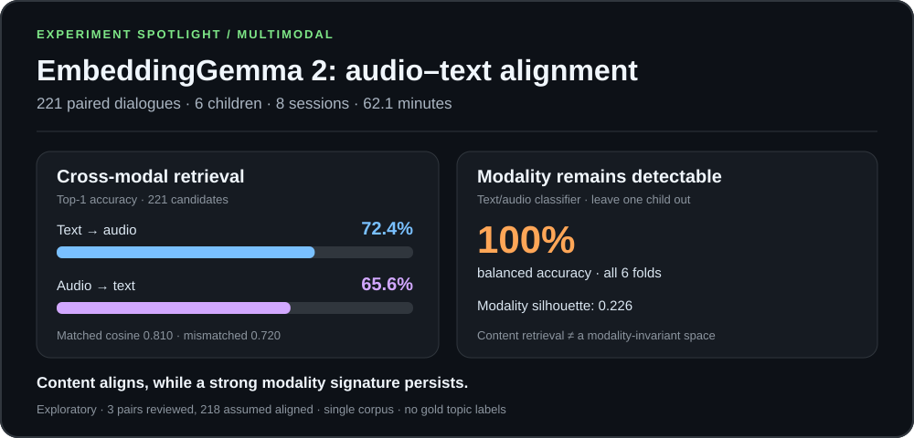
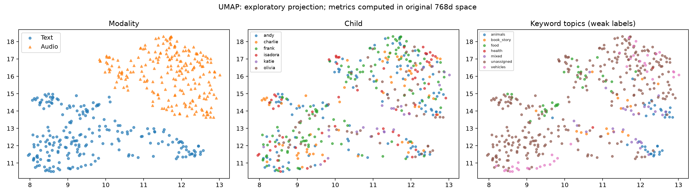
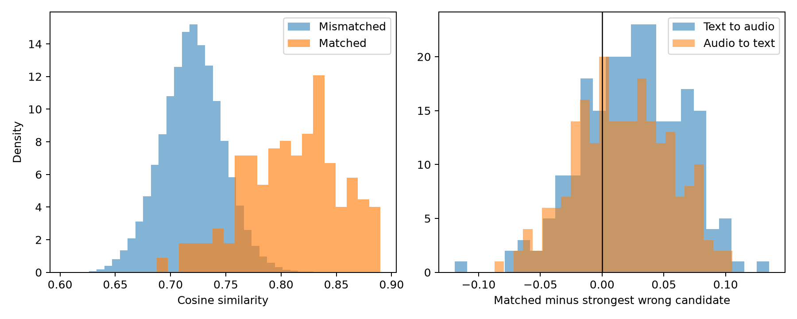

# Expanded Exp 1: Retrieval Alignment and Modality Bias



Run date: October 28, 2026. These are results from actual model inference. **The model supports substantial cross-modal retrieval of dialogue content, but the results do not support the hypothesis that modality bias has been overcome.**

## Data and verification status

The sample contains **6 children, 8 sessions, and 221 pairs** from the Gleason corpus, totaling 62.13 minutes. Each pair covers a continuous 10–30-second dialogue segment and includes all speakers. The user listened to and reviewed 3 pairs; alignment of the remaining 218 pairs was assumed at the user's request. The complete dataset has not undergone independent listening verification.

Of the initially selected 222 pairs, one 38.7-second segment, represented as a single utterance in the transcript, was excluded before examining retrieval scores because it exceeded the fixed duration limit. All retained clips passed checks of frame counts, PCM payload lengths, the 10–30-second duration requirement, and the timestamp bounds of included transcript turns. The Katie source WAV contains less audio payload than its header declares; preparation therefore used the frames actually readable and respected the transcript's corruption warning. Matching transcript timestamps does not establish that the spoken content and boundaries are correct.

Up to 30 segments per session were sampled with seed 20261028. Andy and Frank each contribute two sessions, one with their mother and one with their father; the other children contribute one session each. This is a convenience sample based on download size and timestamp availability, not a representative sample of the corpus or population.

## Main retrieval results

| Metric | Text → audio | Audio → text |
| :--- | ---: | ---: |
| Top-1 / 221 candidates | 72.4% (160/221) | 65.6% (145/221) |
| Top-5 / 221 candidates | 87.8% | 80.5% |
| MRR | 0.7912 | 0.7302 |

Mean cosine similarity is **0.8099** for matched pairs and **0.7196** for the 48,620 mismatched pairs, a difference of **0.0904**. Uniform random Top-1 selection among 221 candidates would achieve approximately 0.45%; this reference is not a statistical significance test.

Restricting candidates to the same session, with 12–30 candidates per session, gives query-weighted Top-1 accuracy of **83.7% for text → audio and 81.0% for audio → text**. These searches have fewer candidates and are not directly comparable in difficulty to the full candidate pool. They provide supporting evidence that the model can retrieve corresponding content within a single recording session.

Across 500 random subsets of 12 candidates, mean Top-1 accuracy is **90.6% / 85.8%** for text → audio / audio → text. The initial Katie result of 100% on 12 pairs did not generalize unchanged. Repeated subsets are neither independent experiments nor confidence intervals.

## Results by child

All values below are Top-1 accuracy against the complete pool of 221 candidates.

| Child | Pairs | Text → audio | Audio → text |
| :--- | ---: | ---: | ---: |
| andy | 59 | 62.7% | 61.0% |
| charlie | 30 | 66.7% | 53.3% |
| frank | 60 | 70.0% | 61.7% |
| isadora | 30 | 76.7% | 73.3% |
| katie | 12 | 100.0% | 100.0% |
| olivia | 30 | 86.7% | 73.3% |

## Uncertainty and modality bias

The child-macro mean difference between matched similarity and mean same-session mismatched similarity is **0.0916**. A 2,000-resample child-cluster bootstrap gives a 95% interval of **[0.0825, 0.1016]**. With only six children, this interval does not establish precise population-level estimates.

A within-session pairing permutation test with 1,000 permutations gives a one-sided p-value of 0.0010, the simulation's resolution floor. Exchangeability of dialogue segments within a session is an approximate assumption, and temporal dependence was not removed. This is an exploratory supporting test.

The modality silhouette in the original 768-dimensional space is **0.2260**. A linear text-versus-audio classifier evaluated with leave-one-child-out cross-validation achieves **100% balanced accuracy in all six folds**. A strong modality signature therefore persists on held-out children. This can coexist with semantic alignment of corresponding dialogue segments.

The child silhouette is **-0.0197**, and the session silhouette is **-0.0193**. These metrics do not show clear child-based clustering that would by itself explain the retrieval performance. They do not establish that speaker or situational confounds have been eliminated.

## UMAP and HDBSCAN



The panels color the same points by modality, child, and weak transcript-keyword topic labels, respectively. Modality separation is apparent. UMAP is a projection: distances in this 2D view must not be interpreted as original cosine distances. Projections for seeds 42, 7, and 123 were saved.



Matched scores shift to the right but still overlap with mismatched scores. The right panel shows the matched score minus the strongest incorrect candidate's score. A margin at or below zero means the correct pair is not the unique first-ranked result.

HDBSCAN on the original normalized 768-dimensional vectors, using Euclidean distance, min_cluster_size=10, and min_samples=5, produces **2 clusters** and **45.0% noise**. The silhouette among non-noise points is **0.3180**. One cluster contains 199 audio vectors and 16 text vectors; the other contains 28 text vectors. These cannot be interpreted as shared topic-based clusters.

## Limits of the topic-alignment hypothesis

The source data does not provide independent segment-level gold topic labels. An auxiliary analysis using fixed keyword rules assigns 17 pairs to animals, 19 to vehicles, 15 to food, 9 to book_story, 1 to health, 13 to mixed, and 147 to unassigned. The silhouette for single-topic weak labels is 0.0696, but these labels do not replace independent gold annotations. Most pairs remain unassigned, and the rules do not fully identify semantically difficult negatives, such as different scenes from the same book.

**The expanded retrieval, modality-bias, visualization, and clustering analyses are complete.** Strict testing of the original shared-topic-clustering hypothesis still requires independent topic annotation. A local annotation sheet is available at `data/exp1_full_topic_annotation.csv`.

## Failure cases and further validation

Failures include confusion between different scenes in the same book involving a cat, a police officer, and a child, as well as dialogues dominated by deictic expressions such as “this” and “that,” where the concrete referent is absent from the transcript. Listening review is needed to distinguish semantic ambiguity from actual timestamp or transcription errors. Low-scoring pairs are not excluded merely because of their scores.

These results evaluate alignment of linguistic content in dialogues containing both adults and children. They do not evaluate developmental information in child-only speech or clinical validity. Follow-up work includes checking the content and boundaries of failed pairs, independently annotating topics, and replicating on another corpus.

## Reproduction and outputs

The fixed analysis plan is in `EXP1_PROTOCOL.md`; sample preparation is implemented in `prepare_exp1_full.py`, and expanded evaluation in `evaluate_exp1_full.py`. The environment is recorded in `requirements-macos.lock.txt`. The model revision is f9972ac22e696a105c482202646979e33e4b5a1e, with CPU inference, FP32, and batch size 1.

```bash
python3 labs/multimodal/embeddinggemma2/prepare_exp1_full.py
HF_HUB_OFFLINE=1 labs/multimodal/embeddinggemma2/.venv/bin/python labs/multimodal/embeddinggemma2/experiment.py extract --manifest data/exp1_full_manifest.jsonl --output outputs/exp1_full --revision f9972ac22e696a105c482202646979e33e4b5a1e --batch-size 1 --allow-assumed-alignment
labs/multimodal/embeddinggemma2/.venv/bin/python labs/multimodal/embeddinggemma2/evaluate_exp1_full.py
```

In this run, the duration violation was discovered during inference, and `finalize_exp1_sample.py` excluded that pair from the already extracted vectors. The initial extraction is preserved in `outputs/exp1_full_before_qc/`, and the final 221 pairs in `outputs/exp1_full/`. Exclusion followed the fixed duration rule before retrieval scores were examined. The final provenance records the parent extraction, excluded ID, and manifest hash.

Outputs include embeddings.npz, rows.json, provenance.json, full_metrics.json, analysis_provenance.json, query_diagnostics.json, failure_examples.json, cluster_labels.json, UMAP coordinates for three seeds, and distribution and UMAP figures. All 221 PCM clip checks, 10 tests, and the package dependency check passed. Data and raw outputs are excluded from Git. Visualizations containing transcripts are retained locally for review.

GitHub includes this report, static figures under `assets/exp1/`, and aggregate results in `assets/exp1/summary.json`. Raw recordings, transcripts, pair-level records, and the interactive visualization containing transcripts are excluded from commits. The local interactive view is `visuals/exp1-alignment.html`; GitHub Markdown does not execute it.

## Sources

- [Gleason corpus description and citation information](https://talkbank.org/childes/access/Eng-NA/Gleason.html)
- [Gleason corpus DOI](https://doi.org/10.21415/T5101R)
- [Google's official multimodal EmbeddingGemma 2 guide](https://ai.google.dev/gemma/docs/embeddinggemma/multimodal-embeddinggemma-with-sentence-transformers)
- Bellinger, D., & Gleason, J. (1982). Sex differences in parental directives to young children. Sex Roles, 8, 1123–1139. One of the references specified on the corpus page.
