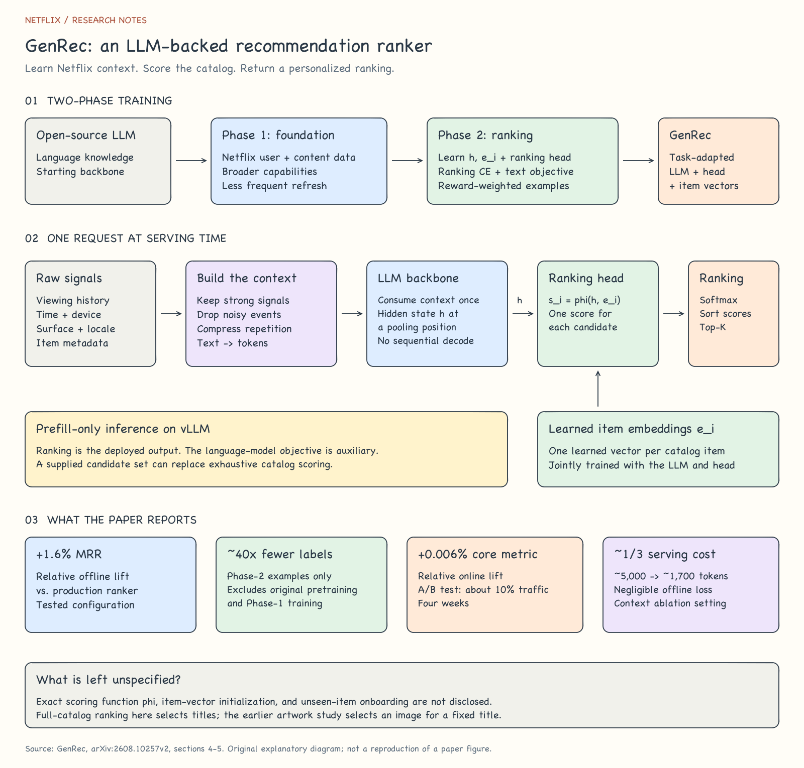
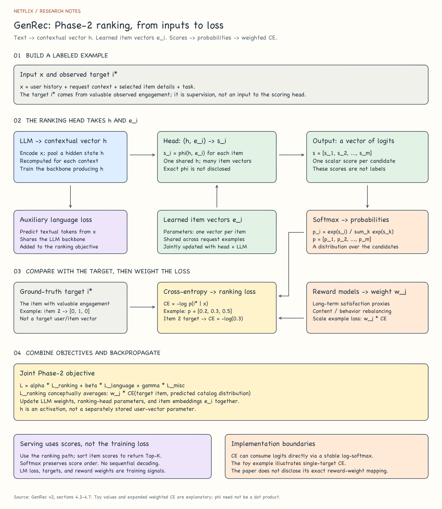

# GenRec: An LLM-Backed Recommendation Ranker at Netflix

> Read user history as text, turn it into a contextual representation, and score catalog items with a learned ranking head.

- **Version reviewed:** arXiv:2608.10257v2, August 21, 2026.
- **Primary source:** [Supplied paper PDF](source/2608.10257v2.pdf), especially sections 4-5, Figures 1-5, and Table 1. [arXiv record](https://arxiv.org/abs/2608.10257v2).
- **Reading aid:** The supplied Korean summary informed the organization. [Source provenance and reading boundaries](source/provenance.md).
- **Language:** English notes and diagrams, following the existing paper collection.

## 1. The system in one picture

[](assets/overview.svg)

[PNG preview](assets/overview.png) · [Editable Excalidraw file](assets/overview.excalidraw)

The overview separates **how the model is trained** from **what happens during a serving request**. GenRec inherits a generative decoder-only LLM, but the deployed recommendation path produces item scores through a ranking head. It does not generate a list of title names token by token.

Open either `.excalidraw` file with **Open** in [Excalidraw](https://excalidraw.com), or drag it onto the canvas. Shapes, text, and arrows remain editable. SVGs use outlined lettering for portable previews; edit the text in Excalidraw. Both figures are original explanatory diagrams, not reproductions of the paper's figures.

## 2. What is being recommended?

Given a user, their past interactions, request context, and item metadata, GenRec ranks the catalog or selects the top K items from a supplied candidate set. Candidate retrieval is a separate concern; this paper focuses on ranking.

This differs from the [artwork personalization study](../netflix-artwork-personalization/README.md): that study chooses an image for an already selected title. GenRec decides which titles or other catalog items should rank higher.

The target is long-term member utility, including satisfaction and retention, rather than immediate clicks alone. Its motivation is also organizational: replace some manually engineered feature interactions and specialized model structures with a shared foundation backbone and deliberate context design.

## 3. Why two training phases? — Section 4.1

| Aspect | Phase 1: Netflix-aware foundation | Phase 2: GenRec ranker |
| --- | --- | --- |
| Starting point | An open-source LLM | The Phase-1 foundation |
| Main purpose | User and content understanding, language capabilities, and instruction following | Recommendation ranking and steering |
| Data and signals | Proprietary Netflix data | Recommendation-specific examples, labels, and rewards |
| Ranking computation | Supplies the starting backbone | Context vector $h$ and learned item vectors $e_i$ feed the ranking head; logits → probabilities → reward-weighted CE |
| Parameters updated in Phase 2 | — | Backbone weights, ranking head, and item embeddings |
| Refresh cadence | Relatively infrequent | More frequent, to track releases and changing preferences |
| Cost emphasis | Build a capable foundation | Meet ranking quality and serving-cost constraints |

Phase 1 supplies reusable capabilities; Phase 2 specializes and refreshes the ranker. The paper focuses on Phase 2 and does not provide a complete Phase-1 training recipe.

Do not import the earlier artwork paper's LoRA-SFT→DPO design into this model. GenRec describes joint training of the backbone, ranking head, and item embeddings, with reward-weighted ranking as its main alignment method.

## 4. From raw events to a useful prompt — Sections 4.2-4.3

Training examples express recommendation logs as single-turn or multi-turn conversations:

```text
User message:
  request context + profile/history + item details + prediction task

Assistant target:
  actual engagement, such as play, duration, abandonment, or feedback
```

This is a training-data representation. It does not require a chatbot interface for members.

Context engineering decides which information fits into the token budget:

| Operation | Examples from the paper | Reason |
| --- | --- | --- |
| Keep in detail | Long-duration plays and thumbs-up | Preserve strong preference signals |
| Omit | Very short plays and noisy clicks/views | Avoid spending tokens on weak signals |
| Compress | Repeated activity and binge sessions | Reduce redundant history |
| Elaborate selectively | New releases and cold-start items | Supply useful metadata where behavioral evidence is limited |
| Summarize or omit older history | A brief interest summary instead of every event | Favor detailed short- and medium-term history |

This reduces feature engineering without eliminating input design. The engineering effort moves toward selecting, expressing, and compressing context.

## 5. Inside the ranker — Section 4.5

Use the following notation to read the architecture:

| Symbol | Meaning |
| --- | --- |
| $H$ | User interaction history |
| $M_i$ | Metadata for item $i$ |
| $\tau$ | Request context, such as device, surface, locale, and time |
| $x$ | Verbalized input text |
| $h$ | LLM hidden state at a pooling position |
| $e_i$ | Learned embedding for item $i$ |
| $\phi$ | Catalog-aware scoring head |

The paper specifies the verbalization step as:

$$
x = V(H, \{M_i\}_{i\in C}, \tau)
$$

After encoding $x$, the LLM supplies $h$. The head combines that representation with each item's learned vector. In explanatory notation:

$$
s_i = \phi(h,e_i), \qquad
p(i\mid x) = \frac{\exp(s_i)}{\sum_{k\in C}\exp(s_k)}
$$

Sort the scores to obtain a ranking. Softmax converts scores to probabilities without changing their order. The paper also mentions sampled softmax when exhaustive catalog scoring is too large.

**Jointly trained components:** LLM weights, scoring-head parameters, and item embeddings. The item vectors are a separate input to the ranking head; the paper does not say that a text encoder directly creates them from descriptions.

The exact pooling position, concrete form of $\phi$, item-embedding initialization, and onboarding procedure for entirely unseen items are not disclosed. In particular, $\phi(h,e_i)$ should not be assumed to mean a dot product. More detailed metadata for cold-start items does not establish immediate support for unseen items without model or embedding updates.

## 6. How training signals fit together

[](assets/training.svg)

[PNG preview](assets/training.png) · [Editable Excalidraw file](assets/training.excalidraw)

### Phase-2 ranking: inputs, output, and supervision

There are two input boundaries to distinguish:

| Boundary | Inputs | Output |
| --- | --- | --- |
| Full ranking model | Verbalized context $x$, with learned item embeddings as model parameters | One logit per catalog item or candidate |
| Ranking head | Context-dependent $h$ from the LLM, plus each item's learned vector $e_i$ | Scalar logit $s_i=\phi(h,e_i)$ for each item |

**Where $h$ comes from:** The LLM processes $x$ and provides a hidden state at a pooling position. It is recomputed for the current history and context, rather than being a fixed user-ID embedding. Training gradients through $h$ update the LLM weights that produced it; $h$ itself is an activation.

**Where $e_i$ comes from:** Each item has a learned vector, shared across training requests. These vectors are trainable parameters, updated jointly with the ranking head and LLM. The paper does not disclose their initialization or say that a metadata encoder generates them.

For an example with $m$ candidates:

```text
Context x -> LLM -> h --------------------+
                                         +-> phi(h, e_i) for each i
Learned item vectors [e_1, ..., e_m] ------+
                                                     |
                                                     v
                                     logits s = [s_1, ..., s_m]
                                                     | softmax
                                                     v
                                     probabilities [p_1, ..., p_m]
                                                     | compare with target i*
                                                     v
                                              CE = -log p_i*
                                                     | reward-derived weight w
                                                     v
                                              ranking loss = w * CE
```

The **target** is the item associated with valuable observed engagement. It is supervision for the loss, not a target user vector or item vector for the head to reconstruct.

For illustration only, suppose there are three candidates, the target is item 2, and the predicted distribution is $[0.2,0.3,0.5]$. The one-hot target is $[0,1,0]$, and the example contributes $w[-\log(0.3)]$ to the weighted ranking objective. This toy example explains single-target CE; it is not actual Netflix data or a complete description of its label processing.

In a numerical implementation, cross-entropy can consume logits directly and use a stable log-softmax internally. The explicit softmax above explains the probability interpretation. At serving time, sort the item scores to produce a ranking; ground-truth labels and the loss are not needed.

### Ranking and language objectives — Section 4.4

The ranking objective uses cross-entropy over catalog items or a candidate set, with positives derived from valuable engagements. Denoising rules and thresholds vary across content types.

An auxiliary language-model objective learns textual inputs and outputs. It supports language understanding, prompt responsiveness, and possible future text-generation uses. The current serving path uses only ranking.

The paper gives the combined objective as:

$$
\mathcal L = \alpha\mathcal L_{\mathrm{ranking}}
+ \beta\mathcal L_{\mathrm{language}}
+ \gamma\mathcal L_{\mathrm{miscellaneous}},
\qquad \alpha+\beta+\gamma=1,\quad \alpha,\beta,\gamma\ge0
$$

These mixture weights are tunable. The paper does not provide a complete set of production hyperparameters or an exact token-masking recipe.

### Reward-weighted ranking — Section 4.6

Separate reward models contribute two types of signals:

1. **Long-term satisfaction proxies:** Estimate whether an engagement is associated with return visits, broader exploration, or sustained participation.
2. **Behavior rebalancing:** Reflect content-type and launch-stage goals, such as balancing movies, shows, games, and live content.

The reward signals determine an example weight. A conceptual expression for the resulting ranking objective is:

$$
\mathcal L_{\mathrm{ranking}}
\approx \frac{1}{N}\sum_{j=1}^{N}w_j\big[-\log p(i_j^*\mid x_j)\big]
$$

This weighted-CE expression explains the mechanism; it is not a separately numbered equation from the paper. The exact reward-to-weight mapping and normalization are unspecified.

Reward weighting scales the contribution of each example to training. It does not directly insert a reward score into the serving-time ranking head. The paper reports preliminary gains from RL-style methods such as GRPO, but uses reward weighting as its main alignment mechanism because of simplicity, stability, and training cost.

## 7. Serving: one context pass — Section 4.7

GenRec uses Netflix's internal LLM serving stack with vLLM in **prefill-only** mode: process the input context once, compute the contextual representation, and score the candidate set in a single forward pass.

Avoiding token-by-token decoding and beam search removes an important source of serving overhead. Input processing and catalog scoring still require computation. Model size and context length remain major cost controls; the paper also explores smaller or distilled models.

## 8. Results with their comparison bases — Section 5

| Result | Reported finding | Comparison and scope |
| --- | --- | --- |
| Offline ranking | About **+1.6% relative MRR** | Versus the mature production ranker in the tested configuration |
| Phase-2 data efficiency | About **40x fewer labeled examples** | Phase-2 examples only; excludes original LLM pretraining and Phase 1 |
| Short-term online metric | **+0.115%** homepage engagement; $p=3.1\times10^{-10}$ | Reported treatment effect versus production, Figure 3 |
| Long-term online metric | **+0.006% relative** core-metric improvement; $p=0.025$ | Versus production; the metric's detailed definition is not disclosed |
| Context compression | About **5,000 → 1,700 tokens** | Negligible offline quality loss in the context ablation |
| Serving-cost reduction | About **one third of the original cost** | Compressed versus original context, not GenRec versus the traditional ranker |

The online test ran for **four weeks on about 10% of Netflix traffic**, focusing on key batch-compute surfaces. The paper reports statistically significant gains in both online metrics. These figures should not be converted into specific retention or watch-time increases, or interpreted as percentage-point changes.

MRR rewards placing the relevant item early: reciprocal rank is 1 for first place, 1/2 for second, and 1/10 for tenth; MRR averages this quantity over examples.

### Ablations use different baselines

| Experiment | Reported observation |
| --- | --- |
| Phase-1 foundation versus an off-the-shelf LLM | Roughly 10-20% improvement in offline ranking metrics |
| Phase 2 versus a freshly trained Phase-1 model | Roughly 35-50% further improvement |
| Phase 2 versus the less frequently refreshed Phase-1 model after two weeks | Relative advantage grows to roughly 80%; the paper attributes part of this to backbone staleness |
| Phase-2 data scale | Increasing data from 1x to 20x improves MRR for both approximately 1B and 10B backbones |
| Model scale | Larger backbones perform better in the tested approximately 1B-10B range under the same GPU configuration and similar training time |

Do not add these percentages to the +1.6% production comparison. They describe different experiments and reference models. The observed scaling trends also do not establish unlimited returns from larger models or datasets.

## 9. What to remember

GenRec combines a Netflix-aware foundation with frequently refreshed ranking adaptation. Context engineering controls the information and cost of the LLM pass. A catalog-aware head converts the pooled representation and learned item vectors into scores; reward-weighted examples and an auxiliary text objective guide training.

The reported results support this design on the batch-compute surfaces tested. They do not establish that every Netflix recommendation surface has migrated to GenRec, that the method is universally cheaper than traditional rankers, or that total training data and cost fall by 40x.
