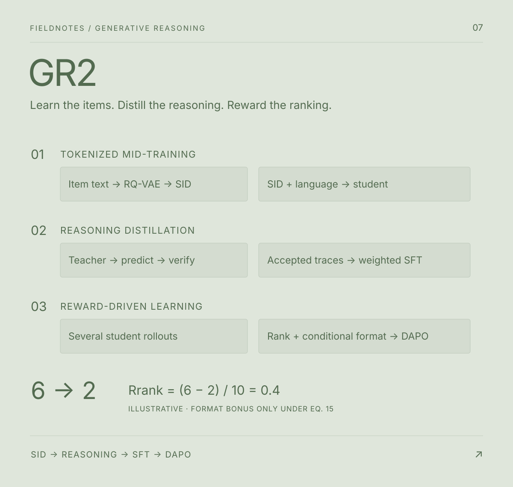

# GR2: Generative Reasoning Re-ranker

> Learn an item language, distill selected teacher reasoning, and reward actual ranking improvements.

[Interactive study](https://1nilx2.github.io/Deep-Learning/studies/gr2/) · [Paper v6](https://arxiv.org/abs/2602.07774v6) · [Source PDF](source/2602.07774v6.pdf) · [Overview SVG](assets/overview.svg) · [Archived handwritten reading map](source/understanding.jpg)

Mingfu Liang et al., Meta AI. Reading source: **arXiv:2602.07774v6**, dated 23 June 2026 on the arXiv version stamp. The first page also prints “Date: January 1st, 2026”; these notes identify the supplied version by its arXiv stamp. This is a paper study, not a reproduction or benchmark. The English explanation follows a personal handwritten reading map, with definitions checked against the paper. All interactive controls are local calculations or authored examples.



## 1. The task: reranking after retrieval

GR2 reads a purchase history and a candidate list already ordered by a retriever. It generates a new order that aims to move the next purchased item upward. The paper uses ten candidates in its reranking experiments.

The starting question is: how can LLM reasoning help refine the final recommendation order? Follow item representation, teacher-generated training data, and rewards for actual ranking improvements as one connected pipeline.

- **Model input:** system instructions and a user message containing purchase history and candidates. Items include SIDs, titles, and category information.
- **Generated response:** a reasoning explanation τ and candidate ranking o; Section 3.1 provides a structured JSON example.
- **External label:** the observed next purchase, used for selecting training data and computing rewards, not provided at serving time.

## 2. From the reading map to the paper

The reading map follows tokenized mid-training → reasoning-data generation → reinforcement learning with DAPO. The paper’s final reasoning-enablement stage includes **both SFT and RL**. In the seven-chapter website, reasoning-data selection and SFT share one chapter; reward design and DAPO have separate chapters.

| Reading-map intuition | Precise interpretation |
| --- | --- |
| Product names may not identify a particular item | Semantic IDs combine codes learned from text features with RQ-VAE. General ID-string tokenization does not itself encode product similarity. |
| Keep teacher explanations that accompany correct predictions | Rejection sampling withholds the answer from the teacher and verifies predictions externally. Targeted sampling reveals the answer first. |
| Reasoning loss plus ranking loss | Both are weighted NLL over segments of the generated assistant response, rather than losses from a separate scalar ranking head. |
| Sample several responses and score them | Compute group-relative advantages across rollouts of one prompt. Candidate-list size and rollout-group size are different quantities. |
| A reward model evaluates AUC or NDCG | The explicit reward uses target-rank movement and conditional format checks, rather than a separately trained AUC/NDCG reward model. |
| Prevent copying the input order | If the target was not initially first, copying alone earns no format bonus. This does not prove that all order bias is removed. |

Figure 1 includes “Reward Model” and “Reference Model” boxes. For reward arithmetic, these notes follow the explicit definitions in Sections 4.3.1–4.3.2, Eqs. (14)–(15).

## 3. Tokenized mid-training: identity and meaning

### Why Semantic IDs?

To recommend with an LLM, first decide how to represent products. A model may already know that someone who bought shampoo could need conditioner. But a real recommendation must go beyond naming a product category: the model must read which shampoo was purchased, compare the particular conditioners in the candidate list, and refer to a specific item.

Product names alone can leave that reference ambiguous. If a model says “shampoo,” we know the kind of product, but not which of the many shampoos in a catalog it means. Descriptions convey meaning; the recommender also needs a consistent way to distinguish individual items.

What about ordinary item IDs? “84721” and “19306” can identify two products precisely, but the numbers do not tell us whether both are shampoos or entirely different objects. If every item ID is also registered as its own new LLM token, the item vocabulary and embedding table grow with millions or billions of products.

One could split ID strings with a general tokenizer such as BPE and reuse existing token fragments. Yet a fragment of “84721” is just part of an arbitrary identifier. Two IDs sharing “84” need not describe similar products. This is the central question in the reading map: can we represent product meaning without assigning a separate new token to every item?

Semantic IDs address that question by representing each item as a combination of short codes chosen across several levels. Similar items can share some codes, while the complete combination helps distinguish individual products. The number of possible combinations multiplies across levels even when each level has a limited code vocabulary.

A broad-to-fine classification is a useful intuition, but these are not hand-written labels such as beauty → hair care → shampoo. GR2 learns codes from product text features with RQ-VAE. Earlier levels approximate the representation, and later levels account for residual differences. The paper also randomizes the last levels to improve distinguishability, so not every code is an interpretable category.

Creating the codes does not mean a pretrained LLM already understands them. The model therefore receives further training on examples connecting SIDs with product descriptions, categories, and user interactions. Next-token prediction over codes and natural language teaches their relationships. This is tokenized mid-training: establish a language for handling items before teaching the model to reason about them.

The name, ID, and BPE comparison explains the reading-map intuition; it is not a direct three-way experiment reported in the paper.

### Learning the SID tokenizer (Section 2)

Encode product text features x, then apply residual quantization with RQ-VAE. Each level approximates the remaining residual using a codebook vector, yielding SID = (z₁, …, zₖ). Reusing level-specific code tokens avoids assigning one independent vocabulary token to every product. The numeric code values are not human-readable semantic descriptions.

The paper examines RQ-k-means initialization, EMA, diversity loss, dead-code reset, and random assignment at the last levels. Table 2 identifies EMA and random last levels as important for the reported ≥99% uniqueness configurations. This is empirical uniqueness, not a mathematical guarantee that collisions are impossible. Randomized last levels also trade some semantic fidelity for distinguishability.

**Uniqueness and recommendation quality are different criteria.** Contrastive loss reduces uniqueness on average across the Table 2 ablations, but improves downstream recommendation within the ≥99% configurations evaluated in Table 3. The selected configuration uses dead-code reset, EMA, random last levels, and contrastive loss, without diversity loss.

### Aligning the LLM

Mix SIDs and natural-language tokens during training to connect item representations with pretrained language knowledge; see Appendix B for alignment-task examples. This is more than storing ID strings or translating every SID into prose. The mid-trained model also serves as a retriever that produces candidates.

The explorer uses an illustrative three-level vocabulary with 16 codes per level: 48 level-specific code tokens allow 4,096 possible tuples. These assumed counts are not the paper’s codebook sizes or a guarantee of collision-free capacity.

## 4. Reasoning distillation and student SFT

The goal is distillation: teach a student model from a larger teacher. Give the teacher a purchase history and recommendation candidates, then ask it to generate both reasoning and a predicted ranking. Do not reveal the actual next purchased item in that input.

After generation, compare the predicted item with the observed next purchase. Discard incorrect outputs and sample again. Retain the reasoning and ranking from correct predictions as student SFT data. This selection procedure is rejection sampling.

The alternative, targeted sampling, reveals the answer first and asks the teacher to explain why it should be selected. This can reduce the need to retry until the prediction is correct, but the teacher has not independently reached that answer. It may rationalize the supplied label and invent supporting evidence.

- **Rejection sampling, Eq. (12):** history and candidates → teacher reasoning and prediction → external target check → discard and retry, or retain for student SFT. Correctness of the selected prediction does not establish that every explanatory claim is true.
- **Targeted sampling, Eq. (11):** history, candidates, and target → a rationale for the supplied answer. Fewer retries may reduce cost, but the rationale can be a post-hoc justification with invented evidence. This is a structural cost observation, not a measured cost reduction reported here.

The prompting recipe uses role and task definition, joint presentation of history and candidates, domain knowledge priming (KP), SID-citation constraints, and a structured explanation. A heuristic such as shampoo → conditioner is a **hint**, not an observation of an individual user’s true intentions.

### SFT details: explanation and ranking are generated tokens

Section 4.2, Eq. (13):

```text
L_SFT = λr × Σ reasoning-token NLL + λo × Σ ranking-token NLL
λr < λo
```

Apply loss only to the assistant response; system and user tokens provide context. Ranking tokens condition on the explanation and preceding output. A smaller reasoning weight need not imply a smaller total contribution if the reasoning segment is longer or has greater summed NLL. These notes do not infer undisclosed λ values or claim a LoRA training recipe.

SFT teaches a response pattern without directly optimizing the final ranking metric. Tables 5–6 include SFT settings that perform worse than Pre-rank. The website retains the loss explorer as expandable detail inside the data-and-SFT chapter.

## 5. RL reward design: verifiable rewards and reward hacking

Section 4.3, Eqs. (14)–(15). Ranks are one-based.

```text
Rrank = (r_before − r_after) / |D|

R = Rrank + α Rfmt    if Rrank > 0 OR r_before = 1
    Rrank            otherwise
```

`Rfmt` checks whether reasoning and a ranking can be extracted. It does not directly establish semantic correctness or detect hallucinations. Appendix E describes JSON-first parsing, regex fallback, range validation, deduplication, and appending missing candidates. The teaching explorer assumes **an already valid target rank** and does not reproduce that parser.

With ten candidates, valid format, and illustrative α=0.1:

| Target-rank change | Rrank | Unconditional total | GR2 conditional total |
| --- | ---: | ---: | ---: |
| 6 → 6 (copy) | 0.00 | 0.10 | 0.00 |
| 6 → 2 (improve) | 0.40 | 0.50 | 0.50 |
| 6 → 8 (worsen) | -0.20 | -0.10 | -0.20 |
| 1 → 1 (preserve first) | 0.00 | 0.10 | 0.10 |
| 1 → 2 (exception boundary) | -0.10 | 0.00 | 0.00 |

The last row follows the literal `r_before = 1` condition in Eq. (15): that exception remains open even if the target is later demoted. The explorer does not silently replace it with a stricter rule. The reward does not retrieve an absent target from outside the candidate list.

## 6. RL algorithm: DAPO and group-relative learning

Generate several responses to one prompt and score them. Equation (17) uses:

```text
A_i = (R_i − group mean) / group std
```

An advantage expresses relative reward within the group, not a probability of correctness. If all rewards match, the standard deviation is zero and no relative signal exists. The explorer avoids an undefined division and displays zeros to indicate no signal.

DAPO uses separate lower and upper clipping bounds (Clip-Higher), a token-level objective, and dynamic sampling. The four-rollout illustration computes rewards and advantages only; it does not execute rollout sampling, clipping, or gradient updates. Its group size, α, and population-standard-deviation convention do not establish the training implementation.

## 7. Results: keep the baseline and denominator

Selected values transcribed from Tables 5–6. Beauty uses candidates from the MTL retriever; Sports uses STL. Section 5.4 states that both the retriever and reranker are initialized from Qwen3-8B.

| Dataset | Method | Recall@5 | NDCG@5 |
| --- | --- | ---: | ---: |
| Beauty | Pre-rank (MTL) | 0.7227 | 0.5101 |
| Beauty | SFT-rejection-KP | 0.7091 | 0.4970 |
| Beauty | RL-rejection-KP | 0.7460 | 0.5234 |
| Sports | Pre-rank (STL) | 0.7077 | 0.4796 |
| Sports | SFT-rejection-KP | 0.7090 | 0.4723 |
| Sports | RL-rejection-KP | 0.7077 | 0.4791 |
| Sports | RL-targeted-KP | 0.7083 | 0.4802 |

Beauty RL-rejection-KP versus Pre-rank:

- Recall@5: +0.0233 = **+2.33 percentage points**, approximately **+3.22% relative**.
- NDCG@5: +0.0133 = **+1.33 points**, approximately **+2.61% relative**.

Sports RL-targeted-KP versus Pre-rank:

- Recall@5: +0.0006 = **+0.06 points**, approximately **+0.085% relative**.
- NDCG@5: +0.0006 = **+0.06 points**, approximately **+0.125% relative**.

Do not present the abstract’s “2.4% / 1.3%” as universal relative gains across datasets. Retrieval metrics in Table 4 and reranking metrics in Tables 5–6 have very different scales and should not be combined as if they shared an end-to-end recall denominator. Without confirming candidate-set construction and evaluation populations, do not generalize the reranking values into full-catalog recall. No training reproduction or online A/B experiment was performed for these notes.

## 8. Connections to the existing studies

| Study | Output path | Learning or transformation |
| --- | --- | --- |
| GR2 | Autoregressive explanation + ranking | SID alignment → teacher-data selection and weighted SFT → DAPO |
| [SPD](../spd/README.md) | Item–position matrix → one-to-one assignment | Teacher-ranking distillation, Sinkhorn, Hungarian |
| [GenRec](../genrec/README.md) | Context vector + catalog-aware head → scores | Two-phase training, reward-weighted ranking, prefill-only serving |

Multiple GR2 rollouts describe the **training** procedure; do not assume that serving repeats it unchanged. Reasoning-generation latency, candidate-retrieval limits, selection bias from retaining successful traces, and the factuality of explanations remain separate questions.

## Sources and editing

- Supplied PDF: `source/2602.07774v6.pdf` (unaltered copy). [Versioned arXiv source](https://arxiv.org/abs/2602.07774v6). Paper authors retain their work’s rights.
- Original reading map: `source/understanding.jpg`, decoded from the supplied HEIC image and retained as an archival reference. The deployed study uses an English interpretation rather than displaying this source image.
- Authored vector diagram: `assets/overview.svg`. Text remains editable; it is not copied from a paper figure. Schematic values are labeled as illustrative.
- Canonical web chapters: `study.json`; explorers: `website/src/study/gr2-labs.jsx`; reward arithmetic: `website/src/study/gr2-math.mjs`.
- The existing website build generates the deployed pages. Edit sources and rebuild rather than editing `website/dist` manually.
