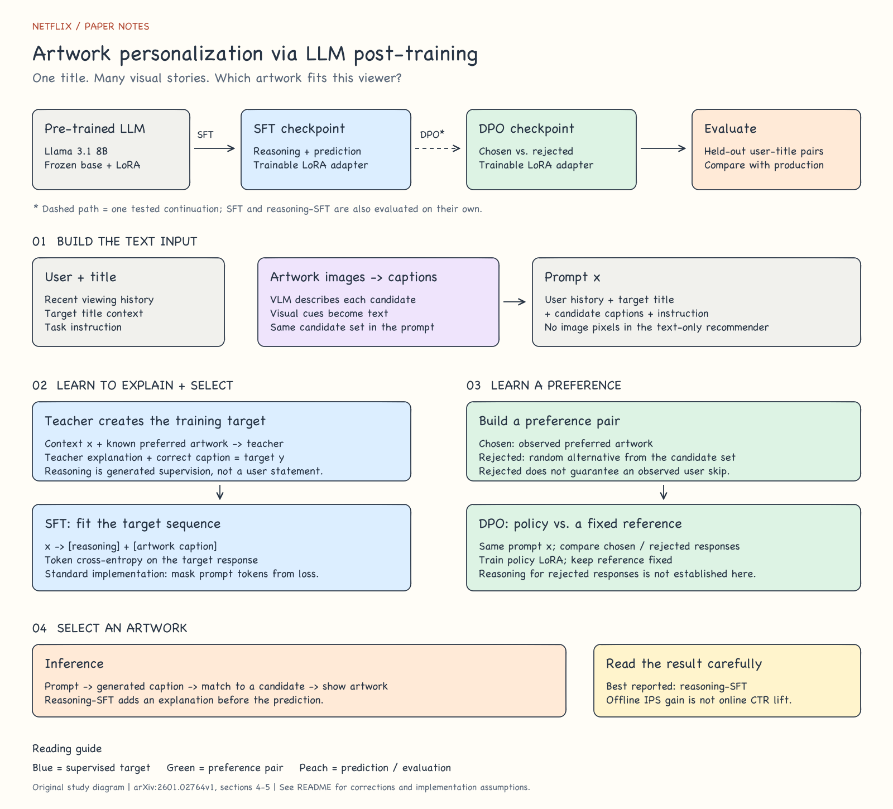

# Netflix Artwork Personalization via LLM Post-training

**[Open the interactive study ↗](https://1nilx2.github.io/Deep-Learning/studies/artwork/)** — Eight chapters with the original FlexCarousel and interactive mechanism explorers. [Study content](study.json).

> Different viewers are drawn to different aspects of the same title. Connect viewing history with the visual cues in candidate artworks to choose the image to show each viewer.

- **Paper:** [arXiv:2601.02764v1](https://arxiv.org/abs/2601.02764v1) · [Full text](https://arxiv.org/html/2601.02764v1)
- **Scope:** Based on the supplied summary and handwritten sketch, checked against sections 4–5 of the paper's first version.
- **Source material:** [English translation of the supplied summary](source/original-summary.md) · [Original handwritten reference](source/flow-reference.jpg)

## At a glance

[](assets/pipeline.svg)

[PNG preview](assets/pipeline.png) · [Editable Excalidraw file](assets/pipeline.excalidraw)

Download the Excalidraw file and use **Open** in [Excalidraw](https://excalidraw.com), or drag it onto the canvas to edit individual shapes and text. The SVG provides a preview directly in the repository. This original study diagram follows the supplied sketch; it does not reproduce a figure from the paper. The source photograph retains the original handwriting.

## 1. What problem does the paper address?

Suppose a title has already been selected for recommendation. If it combines action, family drama, and romance, which aspect should its thumbnail emphasize for this viewer?

The input combines **user history, target-title information, candidate artwork captions, and task instructions**. The output identifies the selected artwork. A VLM first converts visual details such as facial expressions, character composition, and colors into text, allowing a text LLM to process them alongside the viewer's preferences.

## 2. Clarifications to the supplied summary

These corrections follow [sections 4.1–5.3 of the paper](https://arxiv.org/html/2601.02764v1#S4). The source summary is available in English under `source/`; it preserves the draft's claims for comparison.

| Item | Interpretation used in these notes |
| --- | --- |
| Training routes | The paper compares SFT, reasoning-SFT, and DPO. SFT→DPO is one of the tested routes. |
| Selection output | The model generates **caption text**, which is mapped to a candidate using n-gram matching, rather than simply returning an index. |
| DPO rejected response | An alternative is **randomly sampled** from the candidates other than the ground truth. It is not necessarily an artwork the user saw and ignored. |
| Rejected reasoning | Generating incorrect explanations through SFT rollouts or a teacher is not an established procedure in this paper. |
| Meaning of reasoning | The explanation is generated conditioned on a known label. It is not an observation of the user's actual internal reason. |

## 3. SFT: from input to explanation and selection

### Training data

Let $x$ denote the shared prompt, $c^*$ the ground-truth caption, and $r$ the teacher-generated explanation.

```text
x = viewing history + target title + candidate captions + instructions

Standard SFT target:   c*
Reasoning-SFT target:  Reason: r → Prediction: c*
```

The key idea in the supplied summary is to **train the model to generate an explanation before producing its selection**. Giving the teacher the correct artwork and asking it to justify that selection supplies an explanation target that is absent from user behavior logs.

### Loss and updates: general implementation explanation

The following explains the training principle in the supplied summary; it is not a quotation of the paper's implementation code. For a response $y=(r,c^*)$:

$$
\mathcal{L}_{\mathrm{SFT}}
= -\sum_{t=1}^{|y|}\log\pi_\theta(y_t\mid x,y_{<t})
$$

- **Prompt $x$:** Typically excluded from the loss in response-only SFT. Setting `labels=-100` is one way to implement this.
- **Target $y$:** When both the explanation and selection form the target, tokens in both segments receive next-token loss.
- **LoRA:** Freeze the base weights and update the adapters.

The paper does not disclose the exact collator or token-level masking configuration. These settings should therefore be read as a general implementation explanation rather than verified details of its code.

### Why train on the reasoning tokens too?

Training only on selection tokens and training the model to generate explanations are different objectives. Applying loss to explanation tokens directly transfers the teacher's **explanation-generation patterns**. In autoregressive generation, the final selection is also conditioned on the explanation generated before it.

This provides an intuition for including explanations in the target. It does not establish that removing them necessarily causes training to collapse, or that generated explanations reveal the actual causes of user choices.

## 4. DPO: learning a relative preference between responses

### Training data

```text
(x, y_w, y_l)

x  : shared prompt
y_w: response for the ground-truth artwork (chosen)
y_l: response for an artwork sampled from the remaining candidates (rejected)
```

These notes do not assume that DPO responses must have a `reasoning + index` format. In particular, the supplied summary's methods for collecting reasoning for rejected responses are treated as extensions rather than established steps in this paper.

### Loss and model roles: general DPO explanation

$$
\Delta_\theta =
\log\frac{\pi_\theta(y_w\mid x)}{\pi_{\mathrm{ref}}(y_w\mid x)}
-
\log\frac{\pi_\theta(y_l\mid x)}{\pi_{\mathrm{ref}}(y_l\mid x)}
$$

$$
\mathcal{L}_{\mathrm{DPO}}
= -\mathbb{E}_{(x,y_w,y_l)}\left[\log\sigma(\beta\Delta_\theta)\right]
$$

| Model | Role | Updates |
| --- | --- | --- |
| $\pi_{\mathrm{ref}}$ | Provides reference response probabilities | Frozen |
| $\pi_\theta$ | Adjusts the relative probabilities of chosen and rejected responses | LoRA updates |

When DPO starts from an SFT checkpoint, that checkpoint can serve as the starting point for both the policy and the fixed reference. The core idea is to optimize directly on preference pairs without training a separate reward model.

DPO increases the **relative log-probability gap** between chosen and rejected responses compared with the reference. It does not guarantee that their absolute probabilities respectively increase and decrease at every update. If the negative example is not clearly dispreferred, the training signal may also be weak.

## 5. Results and interpretation

Highlights from [Table 1, Table 4, and section 5.3](https://arxiv.org/html/2601.02764v1#S5):

| Method | IPS change relative to production |
| --- | ---: |
| SFT | +2.45% |
| DPO | +2.82% |
| Reasoning-SFT | **+5.21%** |

These are relative improvements in an offline evaluation, not percentage-point increases in CTR or results from an online A/B test. Reasoning-SFT achieves the best result; the findings do not show that adding DPO after SFT always improves performance. The paper highlights uncertainty about whether negative examples represent actual user dislike. DPO accuracy values differ between Table 1 and Table 4, so this summary reports only the IPS improvement shared by both tables.

## 6. Connecting SFT and DPO

| Question | SFT / Reasoning-SFT | DPO |
| --- | --- | --- |
| What is learned? | How to generate a desirable response | The relative preference between two responses |
| Data unit | $(x,y)$ | $(x,y_w,y_l)$ |
| Where do explanations come from? | A teacher conditioned on the known label | A procedure for generating rejected explanations is not established |
| Objective | Cross-entropy on target tokens | Preference log ratios relative to a reference |
| Interpretation limit | Generated explanations are distinct from actual choice causes | A random alternative is distinct from an observed dislike |

Answering the questions in the sketch: **SFT teaches explanation and selection patterns; DPO teaches relative preferences between responses. Their value depends on the training signal and measured evaluation results.**
